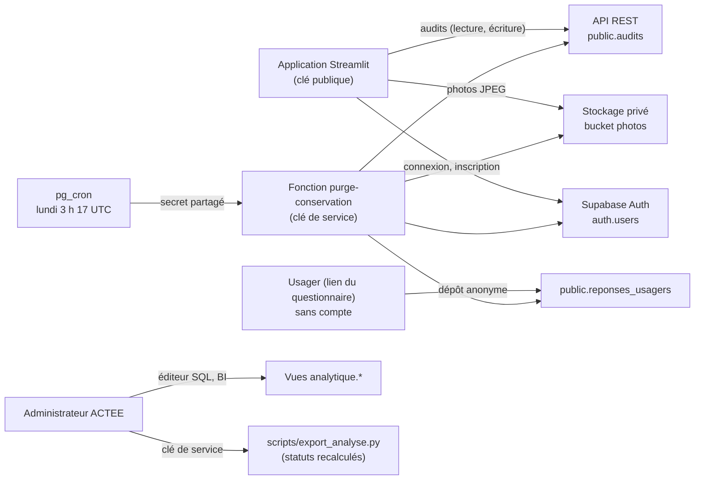
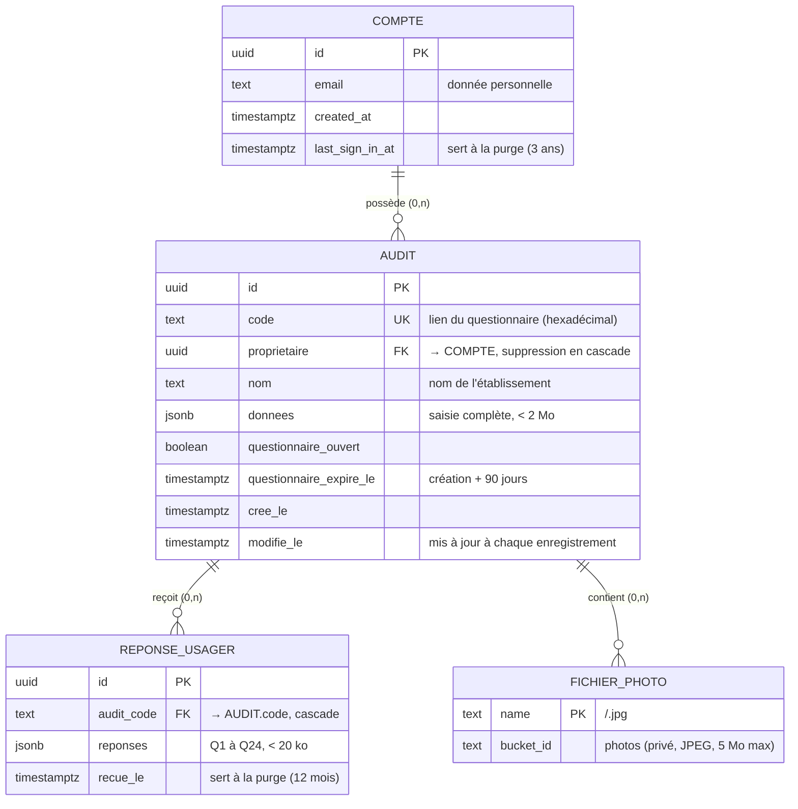
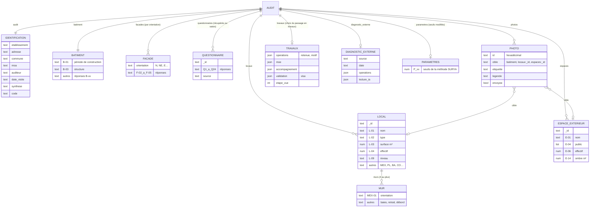

# Base de données de la maquette (Supabase)

Mise à jour du 27/11/2026. Projet Supabase « outil-plan-canicule », hébergé à Paris (AWS eu-west-3), offre
gratuite. Compléments : `docs/supabase.md` (mise en place, conservation, décisions), migrations dans
`supabase/migrations/`, fonction de purge dans `supabase/functions/purge-conservation/`.

## 1. Vue d'ensemble



Choix de conception : **une ligne par audit**, la saisie complète étant rangée dans une colonne JSON
(`audits.donnees`), au même format que l'export JSON de l'outil. Ce format évolue avec la méthode sans
migration de la base ; il est contrôlé à chaque lecture par `surya/validation.py`. Les **statuts ne sont pas
stockés** : le moteur Python les recalcule à partir de la saisie.

## 2. Modèle conceptuel de données (MCD)

### 2.1 Entités stockées dans la base



- **COMPTE** : table `auth.users`, gérée par Supabase Auth (inscription ouverte à tous).
- **AUDIT** : table `public.audits`.
- **REPONSE_USAGER** : table `public.reponses_usagers`. Le lien passe par le **code** de l'audit (celui du lien
  envoyé aux usagers), pas par son identifiant : l'usager ne connaît que le code.
- **FICHIER_PHOTO** : objet du stockage `storage.objects`, dans le dossier de l'audit. Sa description
  (étiquette, légende, local) est dans `audits.donnees.photos`.

### 2.2 Contenu d'un audit (colonne `donnees`)



Le sens de chaque code de question (B-xx, L-xx, MEX-xx, E-xx…) est dans `surya/referentiel.json`
(grille de la méthode SURYA, version du 27/10/2026), qui fait office de dictionnaire des questions.

## 3. Dictionnaire des données

### `public.audits`

| Colonne | Type | Règle |
|---|---|---|
| `id` | uuid | clé primaire, tirée au hasard ; nom du dossier des photos |
| `code` | text | unique, 10 à 32 caractères hexadécimaux ; lien du questionnaire usagers |
| `proprietaire` | uuid | compte qui a créé l'audit (`auth.uid()` par défaut) ; suppression du compte = suppression de ses audits |
| `nom` | text | nom de l'établissement, « Audit sans nom » à défaut ; affiché dans la liste |
| `donnees` | jsonb | saisie complète (§ 2.2), moins de 2 Mo |
| `questionnaire_ouvert` | boolean | le questionnaire en ligne accepte des réponses |
| `questionnaire_expire_le` | timestamptz | création + 90 jours |
| `cree_le`, `modifie_le` | timestamptz | `modifie_le` est mis à jour par un déclencheur à chaque modification |

### `public.reponses_usagers`

| Colonne | Type | Règle |
|---|---|---|
| `id` | uuid | clé primaire |
| `audit_code` | text | code de l'audit ; suppression de l'audit = suppression des réponses |
| `reponses` | jsonb | objet `{"Q1": …, "Q24": …}`, moins de 20 ko |
| `recue_le` | timestamptz | date de réception |

Dépôt anonyme accepté seulement si le questionnaire est ouvert et non expiré, dans la limite de 60 réponses
par 10 minutes et de 2 000 réponses par audit (`prive.questionnaire_accepte`).

### Stockage `photos`

Privé, JPEG seulement, 5 Mo au plus par fichier. Chemin `<id de l'audit>/<id de la photo>.jpg`. Photos
réduites à 1 600 px et visages floutés avant l'envoi.

### Fonctions, tâche et secrets

| Élément | Rôle |
|---|---|
| `public.maj_modifie_le()` | déclencheur : date de dernière modification |
| `prive.questionnaire_accepte(code)` | contrôle du dépôt anonyme (schéma non exposé) |
| `prive.audit_de_l_utilisateur(dossier)` | contrôle d'accès aux photos (schéma non exposé) |
| `public.verifier_secret_purge(secret)` | vérifie le secret de la purge ; rôle de service seulement |
| tâche `purge-conservation-hebdomadaire` | pg_cron, lundi 3 h 17 UTC |
| coffre (Vault) | `purge_url_projet`, `purge_cle_anon`, `purge_secret` |
| vues `analytique.*` | données à plat pour l'analyse (§ 5) ; administrateur seulement |

## 4. Qui voit quoi (règles d'accès)

| Donnée | Auditeur connecté | Usager (sans compte) | Administrateur |
|---|---|---|---|
| Ses audits | lire, créer, modifier, supprimer | — | tout |
| Audits des autres | **rien** | — | tout |
| Réponses usagers | lire et supprimer celles de ses audits | déposer, si le questionnaire est ouvert | tout |
| Photos | celles de ses audits | — | tout |
| Vues `analytique.*` | — | — | lecture |

Les règles sont appliquées par la base (Row Level Security), pas par l'application : même avec la clé
publique, un auditeur ne peut pas lire les audits d'un autre. Testé par le faux serveur des tests
(`tests/faux_supabase.py`) et relu par la campagne de tests n° 2. L'**administrateur** est le titulaire du
projet Supabase : éditeur SQL du tableau de bord, ou clé de service (Project Settings > API), qui passe outre
les règles et ne doit jamais sortir de ses mains.

## 5. Interroger la base pour des visualisations

Les données de tous les comptes ne sont lisibles qu'en administrateur. Trois façons de faire, de la plus
simple à la plus complète.

### 5.1 Éditeur SQL de Supabase, avec les vues `analytique`

Tableau de bord Supabase > SQL Editor. Les vues mettent la saisie à plat (migration
`20261127000100_analytique.sql`) et ne contiennent aucune adresse e-mail :

| Vue | Une ligne par |
|---|---|
| `analytique.audits` | audit : établissement, commune, période, structure, nombres de locaux, d'espaces, de photos, de réponses, passage en travaux, dates |
| `analytique.locaux` | local : type, surface, effectif, niveau, nombre de murs |
| `analytique.espaces` | espace extérieur : public, effectif, ombre |
| `analytique.reponses_usagers` | réponse et question |
| `analytique.comptes` | compte : création, dernière connexion, nombre d'audits |

Exemples :

```sql
-- Audits par mois et par commune
select date_trunc('month', cree_le) as mois, commune, count(*) as audits
from analytique.audits group by 1, 2 order by 1, 2;

-- Locaux audités par type : nombre, surface moyenne, élèves concernés
select type, count(*) as locaux, round(avg(surface_m2), 1) as surface_moyenne, sum(effectif) as effectif
from analytique.locaux group by type order by locaux desc;

-- Bâtiments par période de construction (repérage amiante avant travaux si avant 1997)
select coalesce(periode_construction, 'non renseignée') as periode, count(*) from analytique.audits group by 1;

-- Ressenti des usagers (Q4) sur l'ensemble des réponses en ligne
select valeur #>> '{}' as ressenti, count(*) from analytique.reponses_usagers where question = 'Q4' group by 1;

-- Comptes actifs ce trimestre
select count(*) from analytique.comptes where derniere_connexion > now() - interval '3 months';
```

Le résultat se télécharge en CSV depuis l'éditeur.

### 5.2 Un outil de visualisation branché sur la base (Metabase, Power BI, Looker Studio, Excel)

Ces outils se connectent à PostgreSQL. Ne jamais leur donner le mot de passe principal : créer un utilisateur
en lecture seule, limité aux vues, dans l'éditeur SQL (le mot de passe est à choisir et à garder hors du dépôt) :

```sql
create role lecteur_analytique login password '<mot de passe à choisir>';
grant usage on schema analytique to lecteur_analytique;
grant select on all tables in schema analytique to lecteur_analytique;
-- les vues lisent public.* et auth.users avec les droits de leur propriétaire : rien d'autre n'est ouvert
```

Paramètres de connexion : tableau de bord > Connect (bouton en haut) > « Session pooler » (hôte, port 5432,
base `postgres`, utilisateur `lecteur_analytique.<identifiant du projet>`), SSL obligatoire. L'offre gratuite
met le projet en pause après une semaine sans activité : un tableau de bord rafraîchi chaque jour évite la pause.

### 5.3 Export avec les statuts : `scripts/export_analyse.py`

Les statuts de faisabilité (Recommandé, Sous réserve…) ne sont pas dans la base. Pour les analyser (« dans
combien de classes les brasseurs sont-ils recommandés ? »), le script relit tous les audits avec la clé de
service et recalcule les statuts avec le moteur de l'outil :

```bash
SUPABASE_URL=https://<projet>.supabase.co SUPABASE_SERVICE_ROLE_KEY=<clé de service> python scripts/export_analyse.py export/
```

Il écrit `audits.csv`, `lieux.csv`, `statuts.csv` (une ligne par solution et par lieu : statut, règle retenue,
alertes) et `reponses_usagers.csv`, en UTF-8 avec « ; » (ouverture directe dans Excel ou import dans un outil
de visualisation). L'auditeur y est un numéro (`auditeur_1`…), jamais une adresse e-mail. Les statuts sont
ceux des règles en vigueur au moment de l'export, pour tous les audits.

## 6. Audit de la collecte et de la récupération des données (27/11/2026)

**En résumé : la collecte et le cloisonnement sont bons, la récupération pour analyse est désormais outillée.
Il reste deux limites à traiter avant un usage réel : l'absence de sauvegarde restaurable (offre gratuite) et
les statuts non stockés.**

### Ce qui va bien

- Enregistrement à chaque changement d'étape et à la demande ; photos dans un stockage privé ; questionnaire
  en ligne avec garde-fous (ouverture, expiration, débit).
- Cloisonnement par la base (RLS) : un auditeur ne voit que ses audits ; fonctions de contrôle dans un schéma
  non exposé ; seule alerte de sécurité restante de Supabase : protection contre les mots de passe divulgués
  (offre payante).
- Conservation appliquée automatiquement (purge hebdomadaire des seules données échues), purge désormais
  réservée à la tâche planifiée.
- Format de saisie identique entre la base, l'export JSON et l'import : on peut toujours sortir un audit à la
  main depuis l'application.

### Corrigé le 27/11/2026

| Constat | Correction |
|---|---|
| Ouvrir un audit le réenregistrait avec la saisie affichée avant l'ouverture (un écran vide vidait l'audit en base) | Enregistrement de la saisie courante (`ss.donnees`). Aucune perte constatée dans la base. |
| Une photo non téléchargée à l'ouverture était retirée de l'audit (C2-01) | Photo gardée, auditeur prévenu |
| Un audit vide « Audit sans nom » était créé dès le premier changement d'étape | Rien n'est enregistré tant que rien n'est saisi. La ligne vide créée le 26/11 est laissée en place (à supprimer depuis l'application si vous le souhaitez). |
| Pas de moyen de lire les données de tous les comptes | Vues `analytique.*` et script d'export (§ 5) |

### Limites et recommandations

| # | Limite | Recommandation |
|---|---|---|
| 1 | Offre gratuite : **pas de sauvegarde restaurable**, pause après 7 jours sans activité | Pour un usage réel : offre Pro (sauvegardes quotidiennes, restauration à une date). D'ici là : lancer `export_analyse.py` et un export JSON des audits importants régulièrement. |
| 2 | **Statuts non stockés** : toute analyse des statuts passe par le script | Si les analyses deviennent régulières : enregistrer avec chaque audit un instantané des résultats et la version des règles (colonne `resultats`), pour des requêtes SQL directes et l'historique. |
| 3 | Commune et établissement en **texte libre** | Pour des cartes : ajouter le code INSEE de la commune à l'identification (il existe déjà dans l'accompagnement du passage en travaux). |
| 4 | Le nom de l'auditeur (`donnees.audit.auditeur`) et l'adresse e-mail des comptes sont des **données personnelles** | Vues et export n'exposent ni l'un ni l'autre ; à mentionner dans le registre de traitement (RGPD). |
| 5 | Les réponses brutes sont supprimées après 12 mois | Récupérées par l'auditeur, elles vivent dans l'audit (`donnees.questionnaires`) ; une analyse à plus d'un an doit lire celles-ci (les vues ne lisent aujourd'hui que les réponses brutes). |
| 6 | Pas de journal des accès ni des modifications | Suffisant pour la maquette ; à prévoir si plusieurs personnes travaillent sur un même audit. |
